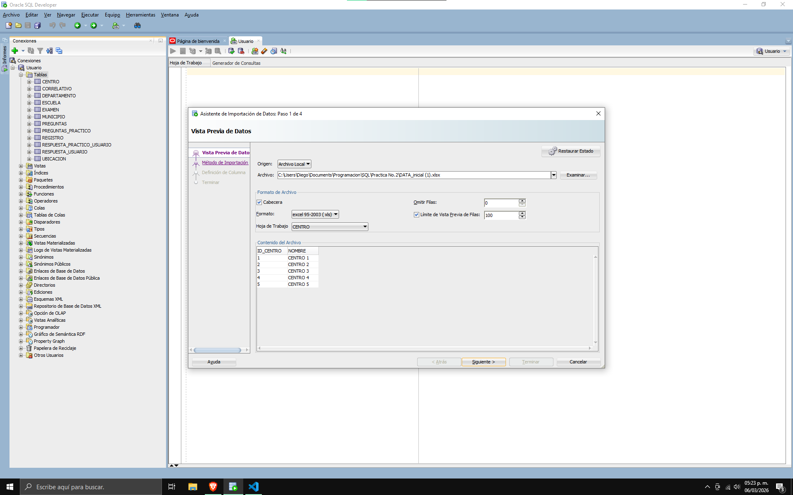

# Manual de Procedimiento de Carga de Datos

- Diego Alejandro Vásquez ALonzo - 202300638

## 1. Introducción

El presente documento describe el proceso técnico seguido para la configuración del entorno de base de datos y la carga masiva de información transaccional proveniente de archivos Excel (`.xlsx`) hacia un servidor Oracle.

## 2. Fase 1: Creación del Modelo (DDL)

Para la creación de la estructura, se utilizó un script SQL desarrollado a partir del análisis de las columnas y tipos de datos presentes en el archivo Excel proporcionado.

### Pasos ejecutados:

1. **Análisis de Datos:** Se identificaron las entidades principales (CENTRO, EXAMEN, REGISTRO, etc.) y sus respectivos tipos de datos (VARCHAR2, NUMBER, DATE).
2. **Ejecución del Script:** Se ejecutó el archivo `scrip.sql` en Oracle SQL Developer para crear las tablas con sus correspondientes llaves primarias y foráneas.

> **Nota:** Se aseguró que los nombres de las columnas en las tablas de Oracle coincidieran con los encabezados del archivo Excel para optimizar el mapeo de datos.

## 3. Fase 2: Proceso de Carga con SQL Developer

La carga de datos se realizó utilizando la herramienta de **Importación de Datos** de Oracle SQL Developer siguiendo este procedimiento:

### Paso 1: Preparación del Archivo

- Se utilizó el archivo `DATA_inicial (1).xlsx` como fuente de datos.

- Se verificó que cada hoja del libro correspondiera a una tabla del modelo.

### Paso 2: Asistente de Importación

Para cada tabla (por ejemplo, `CENTRO`, `PREGUNTAS`, `EXAMEN`):

1.  **Conexión:** Se estableció conexión al servidor de base de datos Oracle configurado.

2.  **Selección:** Clic derecho sobre la tabla destino -> **Importar datos...**
3.  **Configuración del Origen:**

- Formato: `xlsx`.
- Codificación: `UTF-8`.
- Fila de encabezado: Seleccionada para omitir los nombres de las columnas en la carga.

4. **Método de Importación:** Se seleccionó el método "Insertar".
5. **Mapeo de Columnas:** Se validó manualmente que la columna del Excel (Origen) coincidiera con la columna de la base de datos (Destino).
6. **Validación de Tipos:** Se prestó especial atención a los formatos de fecha (`DD/MM/YYYY`) para evitar errores de conversión.

